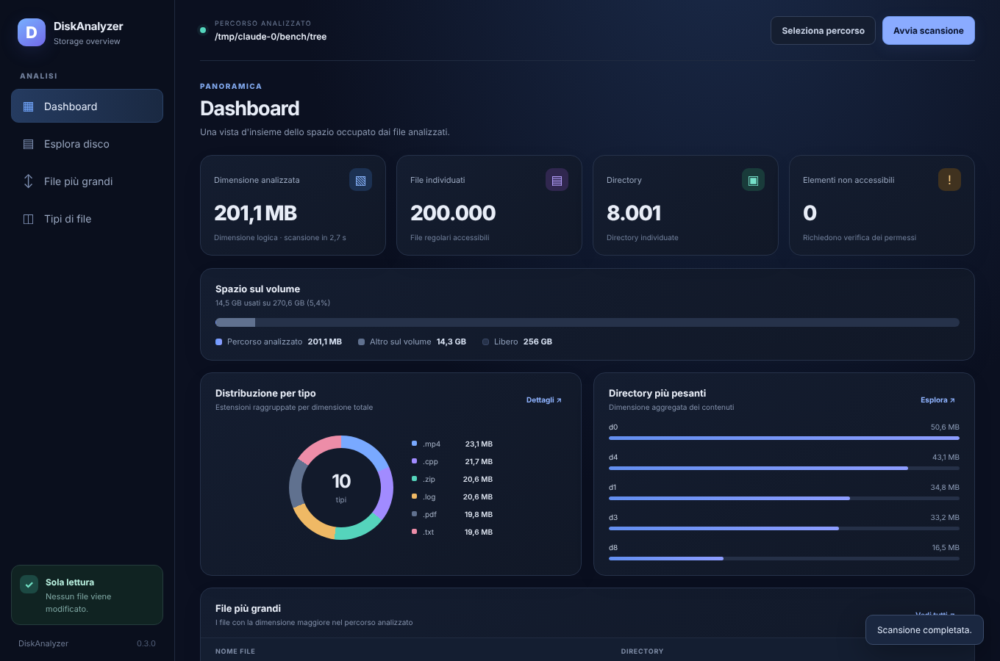
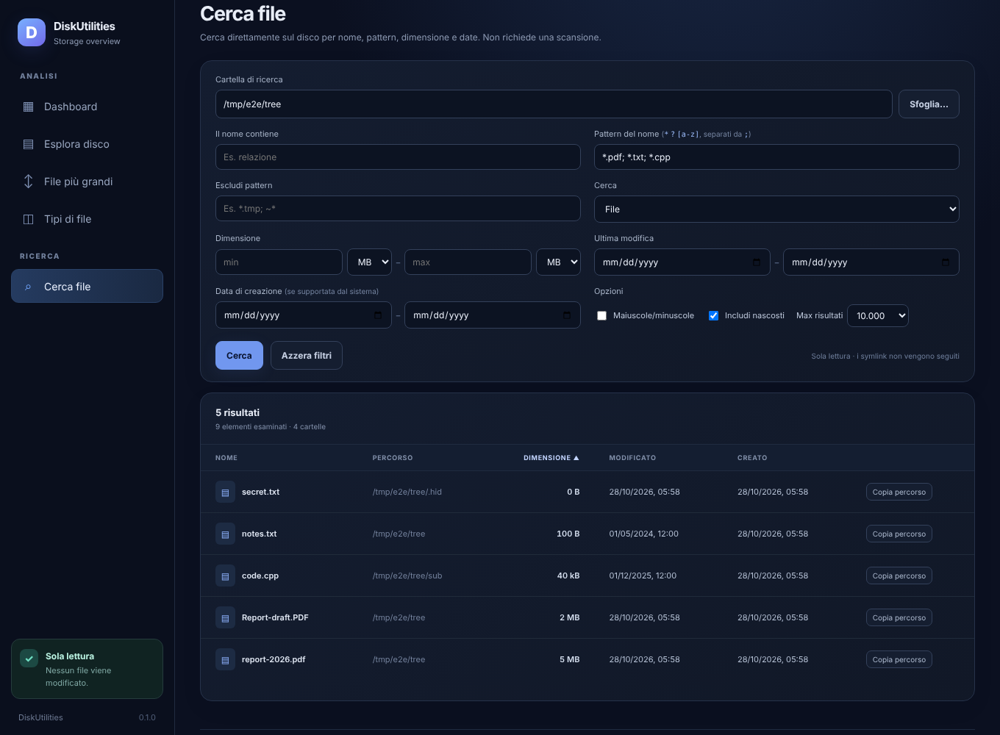
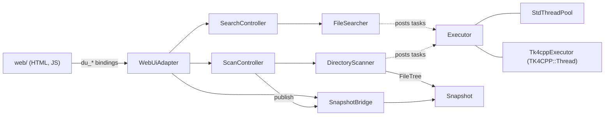

# DiskUtilities

[](https://github.com/ClaudeTO80/DiskUtilities/actions/workflows/docs.yml)
[](https://github.com/ClaudeTO80/DiskUtilities/actions/workflows/ci.yml)

**Read-only** disk utilities: a disk usage analyzer and a file search. A C++23 core scans a disk or a folder
in parallel and indexes the result, and searches the live filesystem by name, pattern, size and dates; a
[WebUI](https://github.com/webui-dev/webui) window renders dashboard, explorer, largest files, file-type
statistics and the search. A command-line tool produces the same data (`diskutilities-cli`, `diskutilities-cli find`).

> **Status:** version 0.1.0 — first public release. The user interface text is in Italian.





## Features

- Parallel scan, one task per directory, with progress, cancellation and a memory-based entry limit.
- **Live results:** while the scan runs, the dashboard, the largest-files ranking and the file-type statistics
  update in real time (counters, volume bar, top directories, biggest files, extension chart), so progress is
  visible. The final snapshot then replaces them with the exact values.
- Immutable indexed snapshot: sizes aggregated once, then every query is cheap
  (sorting, filtering and paging happen in C++, never in JavaScript).
- Never modifies the disk. Symbolic links are recorded but never followed.
- Robust against unreadable directories, invalid UTF-8 file names and trees with millions of entries.
- **Folder chooser:** the "Seleziona percorso" dialog has a "Sfoglia…" browser (breadcrumbs, up button, places such as
  home and drives, hidden folders on demand). A web page cannot obtain an absolute path from a browser file
  picker, so the C++ side lists sub-folders, read-only; typing a path still works.
- **File search** ("Cerca file" view and `diskutilities-cli find`): searches the live filesystem, no scan needed.
  Filters, all combinable (logical AND): name contains, wildcard patterns (`*`, `?`, `[a-z]`, `[!x]`, `\` escape;
  several patterns = OR; exclude patterns), case sensitivity (ASCII), files/folders, hidden entries, size range,
  modification-date range and creation-date range. Parallel, cancellable, results appear while it runs and can be
  sorted and paged; capped (default 10,000, max 100,000) to bound memory.
- Optional [TK4CPP](https://github.com/ClaudeTO80/TK4CPP) integration (`Thread`, `Utility` modules).
- Core library installable and usable through `find_package(DiskUtilities)`.

## Measured on 208,000 entries (scan)

| | Original prototype | DiskUtilities 0.1.0 |
|---|---|---|
| Scan + indexing | 10.8–12 s | ~0.5 s |
| Peak memory | 642 MB | 36 MB |

Totals, per-extension statistics and the top-100 file list are identical in both versions.
Figures come from one machine and one synthetic tree; treat them as an order of magnitude, not a guarantee.

### File search, same tree (200,000 files, 8,001 directories, 2 vCPU, warm cache, release build)

| Search | `diskutilities-cli find` | GNU `find` |
|---|---|---|
| name filter, no match (1 / 2 threads) | 0.49 s / 0.29 s | 0.14 s |
| size filter, stats every file (2 threads) | 0.37 s | 0.34 s (`-size`) |
| creation-date filter, no match (2 threads) | 0.45 s | – (`-newermt` tests *modification* time: 0.30 s) |
| 100,000 matches collected (2 threads) | 0.34 s | – |

A name-only search is about 2× slower than GNU `find`. The measured floor is `std::filesystem` itself: a
single-threaded `directory_iterator` loop over the same tree takes 365 ms against 76 ms for a raw `readdir`
loop. In the GUI the same 100,000-match search took 1.45 s wall (0.6 s in the native search) because the browser
shares the two cores. One machine, one synthetic tree: an order of magnitude, not a guarantee.

## Build

Requirements: CMake ≥ 3.24, a C++23 compiler (GCC ≥ 13, Clang ≥ 18), a browser supported by WebUI for the GUI.
JsonCpp and WebUI are fetched automatically (`DISKUTILITIES_FETCH_DEPENDENCIES=ON`).

```sh
cmake -S . -B build -DCMAKE_BUILD_TYPE=Release
cmake --build build -j
ctest --test-dir build --output-on-failure
```

| Option | Default | Meaning |
|---|---|---|
| `DISKUTILITIES_BUILD_GUI` | `ON` | Build the WebUI desktop application |
| `DISKUTILITIES_BUILD_CLI` | `ON` | Build `diskutilities-cli` |
| `DISKUTILITIES_BUILD_TESTS` | `ON` | Build the unit tests |
| `DISKUTILITIES_WITH_TK4CPP` | `AUTO` | `ON`, `OFF`, or use TK4CPP when `find_package` finds it |
| `DISKUTILITIES_SANITIZER` | empty | `address`, `undefined`, `thread`, `address,undefined` |
| `DISKUTILITIES_INSTALL` | `ON` | Install rules and the package config |
| `DISKUTILITIES_FETCH_DEPENDENCIES` | `ON` | Fetch JsonCpp and WebUI when not installed |

### With TK4CPP

```sh
cmake -S . -B build -DDISKUTILITIES_WITH_TK4CPP=ON -DCMAKE_PREFIX_PATH=/path/to/tk4cpp/install
```

The `Thread` module then provides the scan thread pool and `Utility` the memory limit and the
size formatting. Without TK4CPP the core falls back to an internal `std::jthread` pool.

## Use

```sh
./build/diskutilities [directory]        # GUI
./build/diskutilities-cli --top 50 --tree-depth 3 /var   # JSON report on stdout
./build/diskutilities-cli find ~ --pattern '*.pdf' --min-size 1MB --modified-after 30d -l
```

Scan options: `--top N`, `--tree-depth N`, `--threads N`, `--one-file-system`, `-h`.
Progress goes to stderr; `SIGINT`/`SIGTERM` cancel cleanly (exit code 130).

`find` options (see `diskutilities-cli find --help`): `--name TEXT`, `--pattern GLOB` and `--exclude GLOB`
(repeatable), `--case-sensitive`, `--type f|d|any`, `--no-hidden`, `--min-size N` / `--max-size N`
(`k`/`M`/`G`/`T` = 1000, `KiB`/`MiB`/`GiB`/`TiB` = 1024), `--modified-after|before D`, `--created-after|before D`
(`D` = `YYYY-MM-DD`, `YYYY-MM-DDTHH:MM[:SS]` in local time, or a relative age such as `12h`, `7d`, `2w`; a date-only
"before" bound includes that whole day), `--max-results N`, `--threads N`, `--one-file-system`, `-l`, `--json`,
`-0`. Plain output is one path per line, streamed while the search runs; exit code 0 means the search ran, even with
no match.

### Use the core from another project

```cmake
find_package(DiskUtilities CONFIG REQUIRED)
target_link_libraries(app PRIVATE DiskUtilities::Core)
```

```cpp
#include <diskutilities/analysis/Snapshot.h>
#include <diskutilities/filesystem/DirectoryScanner.h>

auto tree = diskutilities::DirectoryScanner{}.scan("/home");
if (!tree) { /* tree.error().message */ return; }
auto snapshot = diskutilities::Snapshot::create(std::move(*tree));
auto biggest = snapshot->largestFiles(10);

// File search on the live filesystem
#include <diskutilities/filesystem/FileSearcher.h>
diskutilities::SearchCriteria criteria;
criteria.patterns = {"*.cpp", "*.h"};
criteria.minSize = 10'000;
auto found = diskutilities::FileSearcher{}.search("/home", criteria);
if (found) for (const auto& hit : found->hits) { /* hit.path, hit.size, hit.modified */ }
```

## Architecture



| Layer | Directory | Role |
|---|---|---|
| `core` | `include/diskutilities/core` | `Executor` abstraction and `StdThreadPool` |
| `filesystem` | `include/diskutilities/filesystem` | `DirectoryScanner`, `FileSearcher`, `Glob`, `FileTree`, metadata probes, UTF-8 helpers |
| `analysis` | `include/diskutilities/analysis` | Immutable `Snapshot` (aggregates, extension table, paged listings) |
| `web` | `include/diskutilities/web`, `src/web` | DTO contract, `SnapshotBridge`, `ScanController`, `SearchController`, JSON, WebUI adapter |
| `tk4cpp` | `include/diskutilities/tk4cpp` | Optional TK4CPP adapters |
| frontend | `web/` | Plain HTML/CSS/JS; falls back to demo data when no native bridge exists |

Design notes: [docs/design.md](docs/design.md).

## Documentation

The API reference is generated with Doxygen and published on GitHub Pages:
**https://claudeto80.github.io/DiskUtilities/**

```sh
doxygen docs/Doxyfile       # output in build/docs/html
```

## Limitations

- Only the logical file size is measured: hard links and allocated (on-disk) size are not handled.
- Tested on Linux with GCC. The Windows/MSVC and macOS code paths compile conditionally but are untested.
- `--one-file-system` is POSIX only.
- The folder chooser lists drives on Windows through `std::filesystem` only; that branch is untested.
- Creation time: Linux (`statx`, needs a filesystem and kernel that record it) and macOS only. Elsewhere, or where
  the creation time is unknown, a creation filter excludes the entry and the UI/CLI report how many were skipped.
  Not available on Windows yet.
- File search: name matching folds ASCII case only; patterns are `*`, `?`, `[...]` (no `**`, braces or regex);
  results stop at the cap and are then an arbitrary subset; symbolic links and special files are never reported.
- With the search-support release of TK4CPP the CLI reuses its size/date parsers and decimal size formatter; the search engine
  itself still uses the dependency-free core (TK4CPP's `FolderHandler::find` is serial). `FolderHandler::formatSize` keeps its
  1024-based "MB" convention.
- WebUI serves a single client at a time.
- While a scan runs only the dashboard, the ranking and the type statistics are live; the explorer becomes
  available when the snapshot is published. Live rankings may order files of identical size differently from the final one.

## License

MIT, see [LICENSE](LICENSE).
